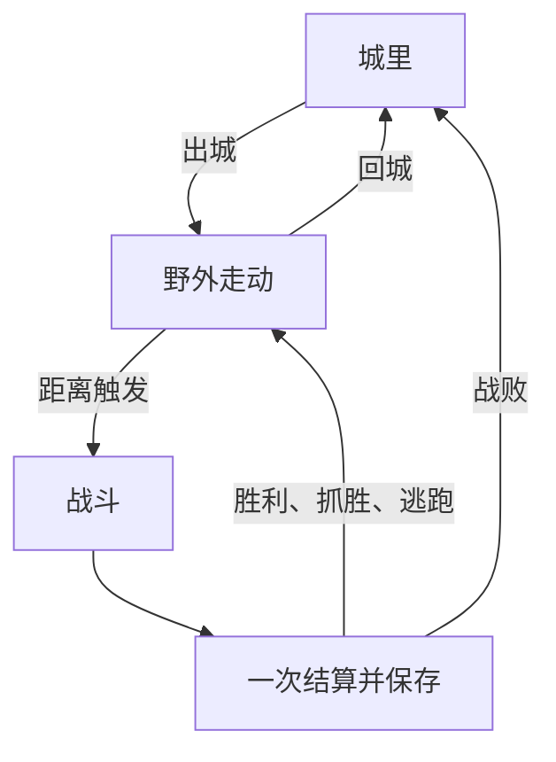

# 青丘灵录｜第二阶段设计定稿与分卡规划

版本：v0.4｜2026-11-13｜状态：玩法定稿、15张分卡规划；不是执行卡，不授权开发。

依据：本次附带的v0.3全文及华周本轮10项文档修订要求。已确认玩法、15张卡顺序与300行上限保持；“其它按建议执行”不扩展为新的存档或进度规则。本轮只更新文档，未修改代码/仓库、未建Issue、未发卡、未运行测试或构建。

**顺序：逻辑整理 → 场景4张 → 技能数据及迁移 → 三类技能效果 → 四项养成 → 平衡 → 收口，共15张。** 每张业务代码和测试合计增删上限300行；估算不是实际差异证明，禁止通过压缩代码、删除有效测试或藏子任务凑数。

工程事实沿用v0.2已核对的main基线`bc9d2a41b6a0c60e0c5d48cfc6f5e8c013d5a1da`，不是本轮实时仓库状态；正式发卡前再核对。旧讨论中的待确认项已按第10节关闭；地图名称、美术裁剪坐标及平衡后的新参数仍需届时确定。

## 1. 已确认的范围与当前事实

| 项目 | 本轮采用的口径 |
|---|---|
| 阶段状态 | 第一阶段已完成，04c 已验收；微信构建与真机预览已提前完成 |
| 第二阶段范围 | 安全区＋一张野外暗雷地图、12个初级技能、物种技能池、道具与掉落、打书、还童、合宠、完整循环平衡 |
| 后备技能与高级技能 | 后备技能不做；数据结构支持高级等级，本阶段不实现高级效果或高级技能书 |
| 其它范围 | 不增加商店、货币、五行克制、装备、门派、联网、支付；音乐以后单独做 |
| 技术 | Cocos Creator 3.8.8、TypeScript、1334×750；沿用 `node:test`，不引入 vitest |
| 执行边界 | 后续 Codex 仅本地提交，不推送、不合并、不 rebase、不强推；华周最终试玩验收 |
| 文档更新 | 第二阶段首卡顺带更新 `docs/roadmap.md`，修正阶段状态并加入已确认的场景范围；按本稿已确认细则更新执行依据，不重做已完成微信构建 |
| 已有包体 | 需求报告主包约 0.69 MB、battle 分包约 2.42 MB；本轮未重建、未实测 |

旧 `docs/design.md` 仅为历史参考。旧版“最多 4 技能、重复书浪费、满格 32% 顶替”等规则被本需求替代，不再沿用。

### 1.1 目录判断：保留分包内纯 TS 逻辑

v0.2基线源码核对发现：`assets/battle/logic/` 的 15 个 TS 文件均未导入 `cc` / `cc/env`；`tests/` 已直接导入分包内 TS；Boot 先 `loadBundle('battle')`，再加载 Battle 场景，没有静态导入战斗模块。

| 位置 | 建议职责与边界 |
|---|---|
| `assets/battle/logic/` | 玩法计算、生成、判定、状态及对应配置；新增计算不直接访问 Cocos、`window`、`wx` 或存储 |
| `assets/battle/scripts/` | 界面、交互、引擎表现与调用逻辑；现有无 Cocos 依赖的 `Battle.ts` 暂留原处 |
| `assets/logic/platform.ts` | 保留现有浏览器参数、微信及本地存储适配；不误称这个目录不存在 |
| `tests/` | 测试继续放这里；“逻辑目录测试”指被测范围，不要求把测试文件搬进游戏资源 |

**为什么这样选：** 纯 TS 能否独立测试取决于依赖，不取决于物理目录。现有测试已经能直接导入分包代码；全量搬出只会增加导入变更和加载风险。以后若多个 Bundle 确实共享同一小段逻辑，再单独讨论该部分。

首卡值得整理的是：`scripts/config.ts` 混放玩法和 UI 参数；`logic/pet-panel.ts` 反向引用这个混合配置。分开玩法与表现参数，保留已有有效配置，不合并成一个大而全的配置文件。`local-progress.ts` 是读写编排，不因为名字带 logic 就把它当作纯计算。

官方依据：[Cocos 3.8 Asset Bundle](https://docs.cocos.com/creator/3.8/manual/zh/asset/bundle.html) 支持脚本随 Bundle 加载，并提示避免不同 Bundle 脚本相互引用。源目录不等于最终构建产物位置；实际主包大小和脚本归属仍须构建检查。

### 1.2 首卡和检查范围

首卡固定为“逻辑整理＋配置化＋测试”，不加技能、道具、地图或其它新功能。新增场景需求不塞入首卡的代码范围。“全部配置化”指所有可调玩法规则、概率、数值都有明确配置来源；数组索引、空列表及控制流中的 0/1 不机械配置化，布局参数仍属于表现配置。

现有抓取、变异、经验、成长等已经有配置，先复用。首卡核对遭遇、身份、资质成长、基础点、伤害、防御与保护、携带召唤、升级及现有正式宠物公式；同一输入与随机序列下，整理前后结果不变。若实估无法在300行内完成，停下报告缺口，不假报“全部完成”；不自动改变本轮15张规划。

路线图同步修正：第一阶段与 04c 完成；放生已完成；微信构建/真机预览移入已完成；第三阶段保留广告、排行榜及上线准备。新内容未来仍需微信回归，但不把已完成的平台构建重复当作待开发功能。

v0.2基线仓库没有 `.github/` 工作流，`package.json` 未声明 scripts 或开发依赖，根 `tsconfig.json` 继承 Cocos 生成的 `temp/tsconfig.cocos.json`。因此不能写“沿用现有 CI”。已采用本地同范围检查；远端CI暂不新增，不将本地结果称为CI通过。限定 tsc 应包含纯逻辑的真实传递依赖，包括纯 TS 的 Battle 和平台接口，不靠排除出错文件获取通过。

另有静态疑点：`local-progress.ts` 导入 `ProgressStorage` 后又声明同名类型。未运行 tsc，不能断言构建失败；首卡核实基线，若确为问题再最小修正并记入 `docs/bugs.md`。

## 2. 数据设计

字段名是设计建议，开发时可复用等价既有类型；不因改命名大面积重构。

| 数据 | 最小字段 | 保存或配置原则 |
|---|---|---|
| 技能定义 | `id`、`name`、`description`、`kind`、`tier`、`familyId`、`params` | 稳定 ID 与显示名分开；kind=主动/被动，tier=初级/高级；本轮仅 12 个初级定义 |
| 物种技能池 | `requiredSkillIds`、`randomSkillIds`、`randomCountWeights`、`mutationExtraCount` | 必带和随机池配置化；不重复、不引用未定义技能 |
| 规则配置 | 技能上限、打书概率表、还童生成范围、合宠门槛/概率/倍率/上限策略 | 放纯 TS 配置；概率抽取由现有或最小随机接口注入，便于确定性测试 |
| 道具定义 | `id`、`name`、`kind`、`skillId?`、`requiredMutation?` | 12 本技能书＋普通/变异还童露；名称和说明自行编写 |
| 背包 | `itemId → quantity` | 同itemId叠为一格，数量为非负安全整数；不限制格数；配置仅预留pageSize=20、stackLimit=99，本阶段不启用；不加重量、货币、商店或自动出售 |
| 宠物持久字段 | 既有 ID、物种、等级、经验、五项、潜能、资质、成长、宝宝/变异身份，新增 `skillIds` | 保存技能 ID 列表，不保存可随意篡改的“必带锁定”标志 |
| 来源与 ID | 保留 initial/captured；合宠增加 fused 与独立 ID 序号 | 还童保留原 ID/来源；合宠新建 ID，不能复用父宠 ID |
| 战斗临时状态 | 当前法力、最终速度/攻击/防御、动作来源、当前战斗结算标志，新增最小结果原因 | 区分胜利/战败/整队逃跑；不把临时加成写回基础资料，不存战斗中途状态 |
| 区域配置与探索状态 | 区域/怪物池配置、位置、目标、距离余数、保护剩余、场景切换锁 | 配置留纯TS；位置及距离只在会话内，读档回城，详见9.3 |
| 会话进度与本场上下文 | 人物/宠物/出战选择的同一有效进度；本场区域与返回点、场次ID | 同一份进度供地图和战斗使用，不为地图虚构一场Battle；持久字段沿用原快照 |
| 存档快照 | 版本、原人物/宠物/出战选择、背包、必要 ID 计数、最近结算标识 | 宠物变化、材料变化与奖励写进同一份完整快照 |

必带由“当前物种＋当前技能 ID”判定：磐龟的硬甲受保护，汀蛙打书学到的硬甲可以被顶掉。必带也占 8 个技能上限中的一个。

高级字段只预留表达能力；本轮不新增高级技能效果、书、优先级或同系叠加系统，相关规则在推出高级内容时再定。

现有 `skill` 单字符串及配置中的“露珠弹”属于旧数据，不能直接转成新技能。新列表以明确的 12 个 ID 为准；旧字段何时移除由实际引用核对决定，不边迁移边大范围清理。

## 3. 技能：数值、触发与战斗过程

### 3.1 已定数值与精确定义

所有名字暂按需求使用，显示说明重新撰写。技能只作用于拥有该技能的召唤兽/野怪，不给人物新增学习渠道。

| 技能 | 需求已定 | 本次确认的精确定义 |
|---|---|---|
| 暴击 | 物理暴击率 +10%，伤害 ×2 | 无技能基础率 0%；每次主物理攻击独立判定，不影响法术/反应伤害 |
| 连打 | 45% 两击，每击伤害 −25% | 每次普攻指令只判一次；触发两击各 ×0.75，未触发单击 ×1；第二击前目标或攻击者死亡则停止 |
| 噬血 | 物理伤害的 25% 回复自身 | 按本次目标及保护者实际失血合计 ×0.25 向下取整；不含超杀溢出，不超过自身最大气血 |
| 还击 | 受物攻时 30%，正常伤害的 50% | 每次主物攻造成实际失血后独立判定；还击使用普通物理计算的 ×0.5，沿用防御，最低有效伤害 1 |
| 反弹 | 受物攻时 30%，所受伤害的 25% | 以自身实际失血 ×0.25 向下取整，可能为 0；不再次扣护甲/防御姿态 |
| 巨力 | 攻击 +等级×0.4 | 用真实等级；叠加到基础面板后统一取整，面板“伤害”与战斗攻击一致 |
| 硬甲 | 防御 +真实等级×0.6 | 只加防御；删除法伤减益，不影响造成或受到的法术伤害 |
| 迅捷 | 速度 +10% | 从基础速度算一次 ×1.1，最终显示和排序使用同一整数值 |
| 回血 | 每回合恢复等级÷2 | 回合开始，仅在场且存活者恢复 floor(真实等级÷2)；0/1 级为 0，不额外保底、不复活 |
| 雷击术 | 单体雷系、伤害随等级提高 | 与火/水共用公式、耗蓝；无克制、冷却、法暴或独立法防 |
| 火球术 | 单体火系，数值同雷击术 | 只改变名称和表现 |
| 水箭术 | 单体水系，数值同雷击术 | 只改变名称和表现 |

没有技能时，既有物理伤害公式、防御、保护分摊、同速规则及愤怒计算保持原样。技能倍率不反复写回基础面板；重新打开面板、换场或读档都不能越叠越高。

### 3.2 已确认动作顺序

1. 回合开始，对在场存活单位结算回血；进入原有指令流程。
2. 防御按现有规则在结算开始生效；按最终速度和原同速规则排序。
3. 普攻执行时先检查连打；每一击独立判暴击，计算物理伤害、连打/暴击倍率，再沿用防御和保护分摊；沿用既有取整顺序，不改变无技能路径。
4. 实际扣血后结算噬血，再反弹，再还击；每一步更新倒地状态。
5. 反应双方都须存活；目标被致死则不还击/反弹。攻击者被反应打倒后，停止后续反应和第二击。
6. 还击和反弹不再触发暴击、连打、噬血、还击或反弹；法术也不触发这批物理被动。用简单伤害来源区分即可，不建立通用事件总线。
7. 保护者的分摊伤害仍扣血并沿用愤怒规则，但首版不触发其还击/反弹；原目标按自身实际失血计算反弹。还击不再次引入保护分摊，避免反应链扩张。
8. 一次动作及其有限反应结束后判胜负，胜利仍只结算一次。主攻击执行前原目标已死的情况沿用既有重选目标规则；连打中途目标死亡则停止第二击。

为什么这样设计：每次出手只有有限的反应，玩家能看清原因；两只都有还击/反弹时也不会无限互打。连打可触发两轮受击判定，因此不能只测试技能单独使用。

### 3.3 主动法术与AI定稿

采用以下初始配置；已获批准，但尚未做平衡验证：

- 有效等级 `L=max(1,真实等级)`。
- 基础法伤 `max(1, round(6 + 2×L + 攻方灵力 − 0.5×守方灵力))`；硬甲不改变该结果。
- 每次耗法力 5；三个法术共用配置。首版不增加法伤随机浮动。
- 法术不走物理防御姿态、物理保护分摊和物理被动；此项已确认。

已有面板提供最大法力和灵力，战斗单位需要引用这些数据。野怪缺少的法力/灵力可复用已有宠物属性计算，但不得顺带替换其气血、攻击、防御、速度基线；敌我原有面板差异留到平衡卡明确调整。

玩家选择“灵术”→展示该宠已学主动技能与耗蓝→选敌方存活目标→提交指令。没有主动技能或法力不足时说明原因，不消耗法力。真正执行成功时才扣蓝；取消、倒地、无可用目标、战斗提前结束不扣蓝。执行时蓝不足改普攻并提示。

同场换下再召回保留余蓝；新战斗回满；升级补满沿用第一阶段规则。回城也回满，同时保留每场回满（Q18已确认）；不做野外跨场血蓝消耗或跨刷新战斗恢复。

野怪AI：有已学主动且蓝够就用；多种等效法术按技能栏顺序选首个；否则普攻。目标沿用原随机存活目标，不额外设计施法概率。玩家自动战斗共用此规则，人物仍走既有自动指令，不获得宠物技能。

为什么这样设计：三个法术目前同数值同目标类型，复杂 AI 没有收益；先让法力资源和技能确实起作用，再依据试玩调整。

## 4. 物种池、生成与展示

| 物种 | 必带（已定） | 随机池（已定） |
|---|---|---|
| 汀蛙 | 无 | 回血、迅捷、连打、噬血、水箭术 |
| 磐龟 | 硬甲 | 反弹、还击、回血、巨力 |
| 毛毛虫 | 无 | 暴击、连打、噬血、迅捷、巨力 |

**雷击术、火球术不进入任何物种的必带池或随机池，本阶段只能通过打书首次获得；以后新增野怪时再配置入池。** 自然生成、初始宠补技能、旧宠迁移和还童抽池都不能抽到两者。合宠仍按已定规则继承双亲通过打书获得的非必带技能，不改遗传规则，也不另增加自然抽取入口。

普通随机数量为0/1/2 等概率；变异在该次结果上 +1，即 1/2/3。无放回抽取，排除必带与重复 ID。数量分布已确认。

生成伪流程：确定物种/宝宝/变异身份 → 添加必带 → 抽随机数量 → 从合法随机池无放回选取 → 验证唯一且总数≤8 → 固定到该个体。

野怪出场时生成一次，战斗使用这一组；抓取继承原组，不再次抽技能。新游戏初始两只汀蛙按普通物种池各自生成一次。还童按重置规则重新抽；合宠按遗传规则，不再叠加物种随机池或“变异额外 1 技能”。

资质技能页保留 4×3 布局：前 8 格显示已拥有技能及空位，后 4 格统一锁定；空格可理解为未拥有，不承诺靠打书填满 8 格。点击已拥有技能显示名称、效果、主动耗蓝；必带角标来自当前物种配置。首版文字占位即可，不为图标阻塞机制。

### 4.1 玩家可见技能说明（供P2-06使用）

浮窗统一为**左图标、右名字、下说明**。若该技能是当前物种必带，在说明下另加一行：**“天生技能，无法被顶替”**；普通学到同名技能不加此行。主动技能说明含耗蓝。P2-06接入以下文案，数字/百分比/倍率均从对应技能配置读取并格式化，不在文案中另写一套常量；花括号仅为模板占位，玩家看到的是实际数字。

| 技能 | 玩家可见说明模板 |
|---|---|
| 暴击 | 物理攻击的暴击率提高{暴击率加成}，暴击时造成{暴击倍率}倍伤害。 |
| 连打 | 普通攻击有{连打概率}概率连续攻击{连击次数}次，每次伤害降低{连打减伤比例}。未触发时伤害不降低。 |
| 噬血 | 普通物理攻击造成实际伤害后，回复相当于实际伤害{吸血比例}的气血，不超过气血上限。 |
| 还击 | 受到普通物理攻击并失血后，若双方仍存活，有{还击概率}概率反击，造成普通物理伤害的{还击比例}。 |
| 反弹 | 受到普通物理攻击并失血后，若双方仍存活，有{反弹概率}概率返还自身实际所受伤害的{反弹比例}。 |
| 巨力 | 攻击提高“自身等级×{每级攻击加成}”。 |
| 硬甲 | 防御提高“自身等级×{每级防御加成}”。 |
| 迅捷 | 速度提高{速度加成比例}。 |
| 回血 | 每回合开始时，在场且存活则回复“自身等级÷{回血等级除数}”点气血，向下取整，不超过气血上限。 |
| 雷击术 | 对一个敌人释放雷击，伤害随等级与双方灵力变化。消耗{法力消耗}点法力。 |
| 火球术 | 对一个敌人释放火球，伤害随等级与双方灵力变化。消耗{法力消耗}点法力。 |
| 水箭术 | 对一个敌人释放水箭，伤害随等级与双方灵力变化。消耗{法力消耗}点法力。 |

暴击/连打/反应等具体执行顺序仍以3.2为准；还击、反弹说明后追加共用短句“反应伤害不会再次触发物理被动技能”。回血除数、连击次数等既有规则同样从配置取值。纯展示格式化可复用现有工具，不新增通用文案引擎。

## 5. 道具、掉落与打书

### 5.1 正式/测试掉落与背包

| 道具 | 正式每胜场掉率 | 测试每胜场掉率 | 每次命中数量 |
|---|---:|---:|---:|
| 技能书 | 8% | 50% | 1本，12种等概率 |
| 还童露 | 3% | 30% | 1个 |
| 变异还童露 | 1% | 10% | 1个 |

三类独立判定，同场可同时获得三类，不按怪物数量多抽。击败最后一只、抓走最后一只都算胜利；失败/逃跑不给整场经验或掉落。

两套数值均写配置，调试开关默认关闭，使用正式掉率。开关只在**同一份存档、同一进度和同一背包**上切换正式8%/3%/1%与测试50%/30%/10%；开启时界面明显显示“测试掉率：技能书50%／还童露30%／变异还童露10%”。测试掉落正常写入这份存档，关闭开关后已获得道具继续保留，供打书、还童、合宠验收使用；不新建测试档、不清理测试所得、不增加道具来源字段或独立库存。

开战时锁定本场使用的概率；战斗中改变开关只影响后续新战斗，本场提示仍反映已锁定的概率。结算重试沿用同一候选，不重抽或混用概率。调试开关只选择配置，不修改配置里的正式数值，也不触发进度重建/存档迁移。

**为什么：** 调高爆率是为了在同一成长进度上取得养成材料并继续验收，分离库存会阻断这条路径。本次删除隔离要求，不借调试开关新增存档机制。

理论节奏：平均 12.5 胜场一书；若 12 本等概率，指定某一本平均约 150 胜场；普通/变异还童露约 33.3/100 胜场。均为概率均值，不是保底，也不是已模拟结果。采用已确认的正式8%/3%/1%，后续平衡调整须经华周批准。

最简背包为道具列表＋数量＋说明，选道具后选携带宠；无物品时显示空态。同种道具按itemId叠一格，本阶段不限制格数、不启用分页或叠加上限。配置预留`pageSize=20`、`stackLimit=99`，仅供以后启用；当前数量超过99仍在同一格累加，不截断、不分栈、不拒绝掉落，也不新增分页控件。本次调整为城里与野外的背包按钮共用同一面板，野外打开立即停止移动和遇怪；战斗中查看可用、养成使用禁用。未实现背包前城里只保留明确未开放的功能位。

胜利伪流程：锁定本场结算 ID → 计算经验及三次掉落 → 构造人物/宠物/背包的完整候选快照 → 同一次保存成功 → 更新界面并显示奖励。重复结算同一场直接返回既有结果，不重新抽取。保存失败保留同一候选结果供本会话重试，不能重抽奖励。

使用递增战斗序号与最近已结算 ID 防重即可；地图往返不能重置序号，回城/刷新也不能被当作上一场的新发奖请求。不加完整交易流水。若刷新发生在保存成功之前，尚未提交的结果不算已获得；旧快照保留。保存成功后刷新不得重复发奖。

### 5.2 打书

按含必带在内的当前总技能数读取需求表：

| 当前技能数 | 新增 | 顶替 |
|---|---:|---:|
| 0～1 | 100% | 0% |
| 2 | 60% | 40% |
| 3 | 30% | 70% |
| 4～8 | 0% | 100% |

选书/宠 → 校验库存、非战斗、是否重复、可替换集合 → 二次确认说明新增/顶替风险 → 抽分支 → 必要时等概率选一个非必带 → 生成技能和库存候选 → 同次保存成功 → 显示“新增 X”或“X 替换 Y”。

已拥有同名对应技能时，不扣书、不抽随机数。有效操作扣一本；不把旧版“失败浪费书”带回来。4 个以上只替换，因此 8 格上限不等于可以靠书扩到 8 格。

无可替换目标的边界：0～1 个仍可新增；2 个以上且规则可能要求顶替时，使用前直接拒绝、不扣书，解释“只有必带技能，无法顶替”。目前最多一个必带，主要用于防止未来配置失效；不偷偷改为必定新增。

战斗外允许给当前出战宠打书，保存后重算派生属性；还童/合宠则禁止出战宠。打书不会删除宠物或重置等级，没有必要照搬放生的限制。

## 6. 野生、宝宝与还童

### 6.1 宝宝与野生点数定稿

共同守恒：`五项已分配合计＋未分配潜能=50＋10×真实等级`；每项基础属性至少1，随机分配复用现有算法和注入随机源。

| 对象 | 五项基础/升级分配 | 未分配潜能 |
|---|---|---|
| 新自然0级宝宝、还童0级宝宝 | 系统随机分配基础50点，五项之和50；不是固定各10 | 0 |
| 宝宝每升1级 | 五项各自动+1，另给5点由玩家选择分配 | 原潜能+5 |
| 新合成L级宝宝 | 独立生成一组随机基础`b_i`，合计50；每项为`b_i+L` | `5L`，全部未分配 |
| 新野生L级宠或合成野生宠 | 系统分配全部`50+10L`点 | 0 |
| 野生宠后续升级 | 按本次“潜能全部由系统分配”：每级五项各+1，剩余5点也自动随机分配 | 不新增玩家可分配潜能 |
| 旧宠迁移 | 已有五项、已花点数、现存未分配潜能全部保留，不自动重分 | 原样保留，原有余额仍可按原入口分配 |

例如合出10级宝宝：基础50点随机＋五项各加10（合计再加50），五项共100，未分配50，总数150；不要求每项都为20。基础随机仅在生成/还童/合成时发生，查看、刷新和普通升级不能重抽。已成长宝宝显示剩余潜能，不强制恒为5L，因为玩家可能已分配。

**旧档明确范围：** 旧存档已有的非宝宝宠，以及`origin=initial`的开场汀蛙，迁移时已有五项和未分配潜能全部保留，旧潜能仍可手动加点。迁移之后的新升级，按野生规则五项各+1、每级额外5点由系统分配；不能将旧潜能余额也自动分掉。初始来源不是重置或排除迁移的理由；若个体已经还童成为宝宝，则按其当前宝宝身份升级，不因origin=initial强制当野生。

**解释与兼容：** 本次“野生宠潜能全部由系统分配”按生成和后续升级均自动分配落文，覆盖旧稿“野生升级也给玩家5点”的建议；老宠“其它资料不动”优先，迁移不消费老野生宠已有潜能。人物升级规则不受此改动影响，仍五项各+1、另给玩家5点。宝宝是身份，不能用等级是否为0代替。

### 6.2 还童伪流程

选露水与非出战宠 → 验证变异身份匹配、非战斗、库存 → 二次确认列出将重置的项目 → 构造候选个体 → 扣 1 露水并同次保存 → 成功后显示新资料。

保留原ID、物种、变异身份及来源；等级/经验归 0，设为宝宝；基础50点随机重分、潜能0；资质、成长与技能重新生成；气血/法力按新面板回满。允许给已有宝宝再次还童，但同样消耗对应还童露且二次确认。

需求写“在物种范围内重随机”，当前宝宝生成使用范围上半段。已定**还童使用完整物种范围**，保留随机风险；自然遇到的宝宝继续按现有上半段规则。两种入口必须分开配置，不因为 isBaby=true 就不加区分地调用旧生成器；此项已确认。

变异还童：从基础范围重抽后只应用一次既有变异资质倍率，不对旧变异资质重复乘倍率；成长不额外加变异倍率。普通露水不能给变异宠用，变异露水不能给普通宠用。

当前存档把 initial 来源限定为普通、非宝宝汀蛙。还童初始宠时必须同时修订对应校验：来源表示历史，不能继续强制它永远不是宝宝。不能只改画面后让刷新报坏档。

## 7. 合宠

### 7.1 资格与结果规则

需求已定：两只都达到配置门槛（初始 10 级）、均非出战、变异只和变异合，二次确认后两旧换一新。

同时要求：两只 ID 不同、仍在携带列表、当前非战斗；普通＋普通产生普通，变异＋变异产生变异，不额外抽变异。合宠无书/露水消耗，不另加货币或成功率。

| 结果项目 | 具体定稿规则 |
|---|---|
| 等级 | floor((A等级+B等级)/2)，沿用当前最高 20 级；新个体经验为 0 |
| 物种 | 异种父母 45% A、45% B、10% 其它；同种合并成 90% 原物种、10% 其它；其它从当前启用且不同于双亲的物种等概率选 |
| 空其它池 | 当前三物种不会为空；未来配置若为空则明确报配置错误并禁用合宠，不静默改 45/45/10 |
| 六资质 | 每项分别取双亲实际值均值 × 独立均匀倍率[0.7,1.1]，最后四舍五入为整数 |
| 成长 | 双亲实际成长均值 × 独立均匀倍率[0.96,1.02]，最终保留 3 位小数 |
| 上限 | 普通资质封顶结果物种普通上限；变异封顶 round(普通上限×现有变异倍率)；成长封顶结果物种成长上限 |
| 下限 | 只要求正值，不抬回物种通常下限，保留 0.7 倍的损失风险；低于通常下限的条形显示正确数值 |
| 变异倍率 | 双亲实际资质已包含变异效果，合宠后不再次乘 1.18；仅用该倍率计算变异上限 |
| 身份与五项 | 任一父母野生→野生，总额50+10L全部随机分配、潜能0；两只宝宝→宝宝，按6.1的随机基础50点＋每级五项各1、潜能5L重建 |
| 携带与出战 | 两旧换一新，总数减少1；原出战宠保持，选中查看对象切到新宠；新ID不与现有/已用ID冲突 |

资质倍率理论均值为 0.9，成长为 0.99；因此合宠在平均数上会降资质、略降成长，并不保证养成收益。封顶还会进一步影响均值。保留需求公式，但必须用结果分布和试玩确认这种风险是否符合目标，不宣传成稳定强化。

### 7.2 技能遗传伪流程

取结果物种必带 → 分别去掉父母各自必带 → 合并剩余技能并去重 → 去掉与结果必带重复项 → 每项独立 40% 遗传 → 若命中超过剩余格，均匀无放回选至 `8−必带数` → 合并成最终列表。

磐龟天然硬甲不参与向汀蛙遗传；汀蛙打书学到的硬甲属于其非必带技能，可以遗传。必带保护随结果物种重新计算。总数达上限时不能总保留数组前几项，否则技能排列会影响运气。

配置必须验证必带数≤8。合宠不再抽随机池、不因变异另加一技能；两亲来源和宝宝/变异身份均独立核对。

### 7.3 操作与保存

简易界面为左右双栏，各显示所选宠的资质、成长、技能格、模型/名字/等级；中间是丹炉和合宠按钮。展示规则概率，不预览随机结果，不做洗炼、学技能等分页。先用现有控件、模型/立绘与丹炉占位完成验收，正式美术在功能验收后再做，不增加本轮独立卡或新玩法。

城里或野外进入合宠（战斗中禁用，打开即停步） → 选 A/B → 展示等级、身份、物种、已拥有技能及规则概率 → 二次确认“两只原宠将消失，结果可能变弱” → 只在确认后生成候选 → 校验点数、技能、ID和上限 → 保存包含新名单的完整快照 → 成功后切换内存与界面。

不展示随机结果预览，不允许取消后重抽结果。保存失败不移除父母，同会话重试使用同一候选；取消、库存/资格发生变化时不扣任何东西。沿用“先保存、再改名单”的现有放生模式，不建立交易日志系统。

## 8. 旧存档迁移与共同安全边界

### 8.1 已确认迁移策略

v0.2基线存档版本为3，兼容1、2。旧宠按当前物种池**补抽一次技能**，包括必带；背包从空开始，旧等级、经验、五项、潜能、资质、成长、身份、ID、出战选择全部保留。相比全部留空，老宠可以直接参与第二阶段；代价是一次随机结果不保证人人一样，该差异已接受。

建议按实际落地阶段升级：v4 引入技能列表；v5 引入背包和奖励结算标识；v6 明确还童后的来源校验及合成来源/ID。这是版本规划，不要求首卡提前添加全部字段；最终号码以届时实际最新版本递增，不能覆盖已有版本含义。

迁移流程：读原始快照 → 按原版本校验并复用已存在升级链 → 保留对应旧版本原始备份一次（不覆盖已有备份）→ 生成缺失字段 → 新版完整校验 → 成功写入后才进入游戏/展示新技能。任何失败都保留旧档并提示，不静默清空为新游戏。

成功迁移后刷新不重抽；失败时不展示尚未提交的随机结果。新增地图后读取成功进入城里，位置与保护距离不参与迁移；战斗中刷新只恢复最近成功保存的进度，不重新结算未完成战斗。旧宠已分配点数不按新的宝宝出生规则重建。对未知技能/道具/版本保留原档、提示不兼容，不静默删除字段来“修复”。

派生战斗属性区分基础结果和技能加成：保存既有基础资料，显示/战斗时重新计算技能效果；不能把巨力/硬甲加成存成新的基础攻击/防御再重复加。旧版本缓存面板先按旧规则验证，再进入新显示计算。

### 8.2 每个持久化操作的共同要求

- 先校验并构造完整候选，写入成功后再替换内存；书/露水数量与宠物变化不得分两次保存。
- 重复确认、快速连点只允许一个操作在途；成功后再次读取最新库存和宠物状态。
- 注入存储抛错时，父宠、目标宠、道具数量、出战引用均保持原值；不吞异常。
- 测试重置只清本游戏数据；备份如何显式清除单独说明，不把普通重置变成清除其它应用数据。
- 单份快照减少半成功状态，但未经平台验证不得声称具有断电级事务保证。

## 9. 场景与美术定稿

### 9.1 安全区、滚屏与可走区域

城里不遇怪，常驻背包、宠物、人物、合宠、出城按钮；野外提供同样的养成入口并把出城换成回城。合宠不限城里/野外，所有养成使用限非战斗；开面板立即停止移动，关闭后需再次点地。未完成的功能位显示未开放，不生成虚假功能。

采用点地直线行走，不做摇杆、寻路、NPC对话、跟随宠物和角色帧动画。地图先标可走区，支持一块凸多边形或多块拼合；桥和溪对岸是不可走装饰。人物立绘复用，行走起伏只作用于表现，不计入实际移动距离。

**野外镜头跟随角色滚屏**，覆盖旧版“不滚屏/整张图塞屏幕”。逻辑视口仍为1334×750，地图世界宽高由正式素材与比例配置，不写死为视口大小、不强行缩成一屏。城里先保持单屏；本次没有要求城里也滚屏。

- 地图层与人物使用世界坐标，HUD/面板使用屏幕坐标，镜头滚动时按钮不漂移。
- 点击先经视口缩放/黑边及当前镜头变换换算到世界坐标；用世界坐标移动和保存本场返回点，不能用屏幕坐标代替。
- 镜头跟随位置受地图边界夹取，边缘不露白；某轴地图小于视口时居中固定该轴。暂停/返回从当前人物位置恢复镜头，不能把镜头补位当人物移动。
- 多块区域时，整个移动线段必须落在可走区域并集内；不能只检测起终点，也不能跨越两块之间的河水空隙。最小策略为不合法直线路径拒绝并提示“不能直达”；不自动绕路、不沿墙滑动。连续连接的多块可直接穿过，前提是整条线段合法。
- 只处理一个有效触点，新合法目标覆盖旧目标；点不可达位置停止并清旧目标。UI拦截事件，不穿透触发移动；边界/判定容差放配置。
- 开面板、切后台、切场景、触发战斗均停步并清目标；关闭/返回后不续走、不补算后台时间。移动速度不受战斗倍速影响。

**为什么：** 滚屏扩大可探索的空间，但并不需要寻路。世界坐标保持不变，才能保证镜头移动不会增加遇怪距离，战后也能回到真正的原位置。

### 9.2 距离遇怪与区域配置

| 配置 | 已确认初始值 |
|---|---:|
| 移动速度 | 180世界逻辑单位/秒 |
| 遇怪检查间隔 | 每实际移动60单位 |
| 每次遇怪概率 | 10% |
| 进入野外保护距离 | 180单位 |
| 战后返回保护距离 | 180单位 |

只有野外、前台、无面板、未切换、人物实际移动时累计。先消耗保护距离，保护内不同时累计抽取距离；保护结束后每满60单位抽一次，失败保留余数。一帧越过多个阈值按路径顺序抽，首次命中就停在触发点并丢弃剩余移动，只开一场。静止、立绘抖动、镜头滚动、传送、撞边、菜单、后台、战斗均不计距离。开关面板不重置保护和余数。

从保护开始，连续移动的理论平均距离`180+60/0.1=780`，约4.3秒；最快240单位，约1.3秒。没有最长等待保底；这只是已采用参数的理论结果，不是实测手感。

| 配置/状态 | 最小内容 | 保存边界 |
|---|---|---|
| 区域表 | 稳定ID、显示名、世界宽高、资源引用、出生点、可走区域、出口、遇怪参数、怪物池、战斗背景 | 配置表支持以后新增区域，本阶段只启用城里/一个野外，不做编辑器 |
| 首个野外怪物池 | 三物种等权；野生1～5级等权；1/2/3只权重50%/35%/15%；宝宝5%、变异25% | 引用既有个体生成，不另抄资质或技能生成规则；宝宝真实0级 |
| 探索会话 | 世界位置、目标、保护剩余、抽取余数、当前区域、切换锁 | 不存位置，不逐步保存；读档回城出生点 |
| 本场上下文 | 场次ID、区域、野外世界返回位置、结果原因 | 触发时固定，加载/重绘不重抽；自动状态引用会话当前值 |

地图名称仍待华周确认，暂以“城里”“野外”占位，不擅自命名。首图不随人物等级匹配野怪。未来多地图的资源/导航开发不因配置支持就视为已完成。

### 9.3 战斗往返、恢复与自动

| 结果 | 去向 | 奖励及保留 |
|---|---|---|
| 击败全部敌人 | 原野外世界位置，停步，重置保护 | 既有经验＋一次掉落 |
| 抓走最后一只 | 同胜利 | 同胜利；抓非最后一只仍继续战斗 |
| 人物有效逃跑成功 | 整队撤离，原野外位置，停步，重置保护 | 无整场经验/掉落；已保存抓获保留 |
| 全队战败 | 城里出生点，人物与全部携带宠血蓝回满 | 无整场经验/掉落，不扣资源，不回滚已保存抓获 |
| 单宠撤退 | 沿用本场退场/召唤流程 | 不等于整队逃跑，不直接返回地图 |

逃跑沿用v0.2批准方案：存活人物有效发出逃跑指令，按原离场处理时点100%整队撤离；人物倒地不能发出有效逃跑，不新增概率或费用。增加最小结果原因`victory/defeat/escaped`；不以enemy胜方或日志文字猜原因。该规则改变旧版只退人物行为，已获华周确认。

每场新战斗仍满血满蓝，回城也满，升级恢复沿用原规则。同场新抓宠保留抓取残血，同场换下召回保留该场血蓝；不做野外跨场续航或战斗中途存档。

自动开关保持会话当前选择，地图可开关，遇怪后自动打；玩家战斗中改动后，下场沿用最新值，不能恢复开战前旧快照。战后停步清目标，需要再次点地；不自动寻路、巡逻或站桩刷怪。刷新默认沿用原有行为，不新增自动设置存档。

动画结束后，停止战斗计时与自动调度，完成一次结算及必要保存再返回地图，显示系统消息；正式删除“再来一场”。保存失败保留本场和同一候选结果，提示重试，不能提前切走或重抽奖励。重复回调、连点、前后台切换只允许返回一次。

### 9.4 共用进度与资源

同一会话进度供地图、面板、战斗共用；不能为城里创建隐藏Battle，不能为了读面板生成野怪。最小解耦已有`Battle.phase === ended`的加点/放生限制，改为真实非战斗上下文；复用保存入口，不建立通用框架。旧档读失败保留原档，不能以新游戏覆盖；出生宠只初始化一次。

地图切换不额外发奖、不重置宠物、经验、技能、背包、出战选择或场次ID。刷新读最近成功快照并回城，未提交奖励不重发。仅地图不新增存档版本，后续技能/背包/养成迁移各在对应卡处理。

华周提供地图，bot裁剪压缩及导入，保留原图；先标可走区再验动作。野外宽图按世界宽高铺设，滚屏展示；城镇地图实际尺寸为**2048×1152（16:9）**，按1334×750逻辑画布等比适配，不采用1672×941；保持等比、不拉伸，视口适配边缘不影响可走区及点击坐标。战斗背景和人物立绘复用，程序动效不扩成帧动画。

资源及玩法逻辑留battle分包，默认在现有入口内切地图/战斗子视图；Boot不静态引用新地图，暂不新建分包。主包不迁入新玩法/地图资源；构建元数据是否字节变化需实测，不预先声称绝对不变。源图不重复放入运行包，保留对应.meta。

包体须同时报告主包、battle及总包；地图压缩大小不代表运行内存和加载体验。Web与微信真机要验证滚屏点击、边界不露白、画面清晰、往返不黑屏。已完成的微信构建不重复列成待开发功能，但新功能仍需平台回归。

## 10. 原Q01～Q22答复归档

以下为已确认结论，不再作为待回答问题。具体覆盖关系以本次答复为准。

| 编号 | v0.4结论 |
|---|---|
| Q01 | 宝宝基础50随机，0级潜能0；合成宝宝每项b_i+L、潜能5L；野生全部系统分配，旧宠资料不动，详6.1 |
| Q02 | 硬甲仅防御+真实等级×0.6；彻底删除法伤减益 |
| Q03 | 老宠按物种池补抽一次技能含必带，其它资料不动 |
| Q04 | 采用3.3初始公式/耗蓝/主动AI；硬甲减伤分支因Q02删除 |
| Q05 | 随机技能数0/1/2等权，变异+1；初始宠生成，抓取继承 |
| Q06 | 采用3.1/3.2组合顺序；无递归反应、未触发连打不减伤、回血向下取整 |
| Q07 | 同一存档切正式8%/3%/1%与测试50%/30%/10%；测试掉落正常保存、关闭后保留；开战锁概率、默认关闭、界面明显标测试；三类独立、12书等权、抓胜可掉 |
| Q08 | 打书可给出战宠；还童/合宠不行；三者战斗中禁用；城里/野外均可；无替换目标按5.2拒绝 |
| Q09 | 还童完整物种范围，自然宝宝上半段；变异资质倍率一次 |
| Q10 | 同变异身份可合并保持；同种90/10，其它等权，空其它池禁用 |
| Q11 | 结果物种资质/成长封顶，不托通常下限；独立均匀倍率、资质整数/成长3位 |
| Q12 | 必带占格，父母各自必带不遗传；超过8均匀截断；新经验0，点数按新版6.1 |
| Q13 | 首卡对齐node:test、本地提交及阶段二文档规则；本轮300行覆盖旧200行 |
| Q14 | 本地逻辑测试＋限定tsc，暂不新增远端CI，不自动推送 |
| Q15 | 约15张规划；单卡业务＋测试合计增删≤300，超量停下重估；不压缩代码凑数 |
| Q16 | 点地直走；野外跟随滚屏；可走区域凸或多块拼合；桥/对岸不可达，无寻路/摇杆 |
| Q17 | 速度180、每60距离10%、进图/战后保护180，配置化 |
| Q18 | 保留每场回满，回城全队血蓝也满，不做跨场续航 |
| Q19 | 有效人物逃跑100%整队撤离；胜/抓胜/逃回原位，败回城全满不扣资源 |
| Q20 | 自动开关跨场沿用最新选择；战后停步，无自动巡逻 |
| Q21 | 单野外复用三物种/1～5级和既有数量/宝宝/变异；读档回城；地图名仍待命名 |
| Q22 | 首卡后场景先行；同battle分包，胜负消息并入返回；新增滚屏以Q16覆盖 |

## 11. 15张分卡规划

本节沿用v0.3的15张顺序，不恢复v0.2旧编号和拆分候选，使用P2-01～P2-15避免与第一阶段卡号混淆。只有规划，尚未制作正式执行卡。估算含业务/UI/工具代码和测试增删；文档、美术、场景资源、生成文件另列，不借资源文件藏业务逻辑。每张至多300行，**接近上限的数字是复用前提下的设计估计，不是对实际diff的保证**。

固定样本复用既有调试入口，由明确选择样本的操作准备所需等级、技能、道具或随机序列；不新增独立测试存档/进度系统。掉率开关本身只选概率，不能借切开关自动替换宠物、发材料或清空进度；样本准备与实际功能验收明确区分，调试条件在报告中列出。

场景仅P2-02～05共4张；技能效果P2-07～09共3张；养成P2-10～13各一张。共用基础在确实需要它的前卡交付，不提前把合宠规则藏进逻辑整理卡。每张先本机浏览器按列明步骤自测，再交华周最终验收。

| 卡 | 目标 | 业务估算 | 测试估算 | 合计 | qa |
|---|---|---:|---:|---:|---|
| P2-01 | 逻辑整理、配置与文档对齐 | 100～160 | 50～80 | 150～240 | 触及存档读写则是 |
| P2-02 | 安全区与共用进度/面板 | 150～205 | 60～90 | 210～295 | 是 |
| P2-03 | 野外滚屏、可走区、城野往返 | 155～210 | 60～90 | 215～300 | 是 |
| P2-04 | 固定遭遇、四类结果返回、系统消息 | 140～200 | 70～100 | 210～300 | 是 |
| P2-05 | 暗雷保护、自动衔接、正式地图闭环 | 120～190 | 60～90 | 180～280 | 是 |
| P2-06 | 技能目录/生成/展示、迁移与点数口径 | 160～210 | 65～90 | 225～300 | 是 |
| P2-07 | 数值类被动：巨力/硬甲/迅捷/回血 | 85～135 | 50～80 | 135～215 | 基础缓存校验改动则是 |
| P2-08 | 战斗触发类：暴击/连打/噬血/还击/反弹 | 140～190 | 80～110 | 220～300 | 不改持久化时普通 |
| P2-09 | 三主动法术、耗蓝、敌方与自动AI | 150～200 | 65～100 | 215～300 | 不改持久化时普通 |
| P2-10 | 背包＋正式/测试掉落完整闭环 | 155～205 | 70～95 | 225～300 | 是 |
| P2-11 | 打书完整操作 | 95～145 | 55～85 | 150～230 | 是 |
| P2-12 | 普通/变异还童完整操作 | 125～190 | 65～100 | 190～290 | 是 |
| P2-13 | 合宠完整操作 | 160～210 | 70～90 | 230～300 | 是 |
| P2-14 | 概率与完整循环平衡报告 | 65～120 | 35～65 | 100～185 | 只读离线普通 |
| P2-15 | 批准参数、调试/动效与平台收口 | 70～150 | 45～85 | 115～235 | 持久校验/依赖变更则是 |

**真实接线重估：** 发卡前，对会改`assets/battle/scripts/BattleView.ts`（约1422行）及`assets/battle/scripts/Battle.ts`（约372行）的卡，必须读取当时真实代码、核对调用链后重估，尤其P2-02、P2-08、P2-13。这里行数是当前文档参考，不冒充当次实测。优先将规则写成纯函数，界面只做薄接线；估算计入调用改动、状态传递、UI绑定和测试，不只计算新增纯函数。超过300仍停下报告，不压缩代码、不删有效测试；不自动拆卡或改顺序。

**规模风险：** P2-02/03/06/08/09/10/13接近门槛，其中战斗触发组合和合宠风险最高。旧稿分成多张不能简单合标题就承诺变少；本版减少中间试用入口和重复接线、复用选择/确认/保存及表驱动测试后才有上述估计。发卡前按真实代码重新估；无法在300行内形成完整闭环时，该卡不能发出。先砍独立皮肤、过渡展示和重复代码，不能砍已确认机制/失败保护/有效测试；仍超量再报告具体拆分影响，不默许301行，也不自行突破15张目标。本轮无需为未测估算提前授权例外。

### P2-01｜逻辑整理（固定首卡）

- 范围/不做：整理既有规则配置、玩法/表现依赖和定向测试；更新路线图阶段状态、实际logic路径、300行/node:test/本地提交口径。不改点数、数值、场景或新玩法，后续规则在对应卡落地。
- 文件：`assets/battle/logic/`、`scripts/config.ts`及必要调用、`tests/`；文档`AGENTS.md`、`ARCHITECTURE.md`、`docs/roadmap.md`与授权范围内`STATUS.md`。
- 逻辑测试：固定随机序列下抓宠、资质、成长、伤害、升级结果不变；旧档回归；限定tsc记录并核实基线疑点。
- 试玩：旧入口打一场、抓一只、加点、刷新，资料和原行为一致。
- 包体/兼容：无新位图，保持battle加载边界；不改档格式，读写改动须qa。

### P2-02｜安全区与共用进度

- 范围/不做：最小分离进度与战斗实例、城里点地移动、人物/宠物面板、五个功能位；未完成入口置灰。不造隐藏Battle，不全拆BattleView、不实现野外。
- 文件：最小探索/会话纯TS、地图视图、`Battle.ts`/`BattleView.ts`、`local-progress.ts`、既有面板和测试。
- 逻辑测试：出生宠只生成一次，旧档/坏档与保存失败保护；城里无战斗tick；真实非战斗加点/放生及出战引用不串；地图输入不穿透UI。
- 试玩：场景预览中走动、开人物/宠物、确认加点后刷新保持、取消不生效；城里没有暗中战斗。正式旧入口保留到P2-05，不为预览另建进度或存档规则。
- 包体/兼容：复用城图/立绘/面板，资源留battle；qa，地图本身不升级存档格式。

### P2-03｜野外滚屏与往返

- 范围/不做：世界地图宽高、镜头跟随/边界、凸或多块可走区域的整段直达判定、出城回城、区域池配置。接正式地图和可走区，暂不开暗雷；不做寻路、桥通行或摇杆。
- 文件：探索/区域配置、地图视图、输入坐标转换、地图素材及.meta、`wild-encounter.ts`必要输入适配、测试。
- 逻辑测试：屏幕/世界转换、镜头边界；端点均可走但线段穿河必须拒绝；连通多块可直达；镜头移动不增加人物距离；传送不累计，首区怪物池与旧规则一致。
- 试玩：出城走到宽图两端，看人物跟随和镜头夹边；滚屏后点目标仍准确，UI不漂；桥/对岸不可达；回城资料不丢。无正式图则占位校验，P2-05前补正式资源。
- 包体/兼容：地图增加battle字节和内存，主包不引入；qa，往返共用旧进度，不存坐标。

### P2-04｜固定战斗往返与结果

- 范围/不做：调试固定入口接现有战斗，区分胜/败/逃、整队逃跑、抓胜及原位置返回；一次结算/保存、自动最新值、系统消息。不提前实现新掉落，不正式开放随机暗雷。
- 文件：Battle/BattleView、探索/会话上下文、结算UI、保存协调与测试。
- 逻辑测试：抓非最后一只继续、抓最后胜利、整队逃跑、单宠撤退、倒地不能逃；败回城，其余回世界原位置；保留已抓宠；重复回调只结算一次；保存失败留场重试同候选。
- 试玩：固定样本四类结束逐一返回，镜头与位置正确；战斗里改自动后下场保持新值；失败回城满血蓝不扣资源。
- 包体/兼容：复用战斗资源，qa；已有经验和保存入口复用，不增加一套奖励账本。

### P2-05｜暗雷与场景正式闭环

- 范围/不做：实际距离抽取/保护、自动打架配合、面板暂停、正式开局/读档回城；取消正式“再来一场”。补齐两地图美术与手机回归；无自动行走。
- 文件：探索纯TS、配置、地图更新/输入、Battle入口、共用模拟与测试。
- 逻辑测试：概率0/1、保护/阈值、不同帧分段等价；一帧多阈值命中即停只开一场；UI/后台/滚屏不累计；刷新回城不重复奖励；真实旧进度接入无损。
- 试玩：城里走不遇怪→出城走动遇怪→开启自动打→胜后原地停步→再走过保护才可能遇怪；背包占位遮罩暂停，败回城，刷新保留宠物。Web及微信真机确认滚屏和按钮触摸。
- 包体/兼容：qa；不存位置，报告主/battle/总包实测；仅检查过的手机项才写通过。

### P2-06｜技能数据、旧宠迁移与点数口径

- 范围/不做：12定义/高级字段、物种池、8+4格展示及4.1的12条说明/浮窗；旧宠补抽一次，新怪生成抓取继承；同步6.1新生成宝宝与野生升级点数，旧投入不重置。不接技能战斗效果、不做还童/合宠。
- 文件：技能/生成配置、roster、基础点/升级纯逻辑、local-progress、现有技能格、tests及共用离线模拟。
- 逻辑测试：技能唯一/必带/数量分布；雷击术/火球术不在任何必带或随机池；浮窗数值来自配置、必带说明按当前物种判定；迁移v1～3及实际版本、写失败保旧、刷新不重抽；老非宝宝宠及origin=initial开场汀蛙的五项/旧潜能原样保留且仍可手加；迁移后野生每级额外5点由系统分配；新宝宝50随机/每项≥1，宝宝升级+5可分配、野生新增5自动分配、人物不变；总额守恒。
- 试玩：旧档技能出现但等级/点数/资质不变；刷新两次稳定；固定样本抓宠对照技能，宝宝和野生各升一级核对分配差异；点技能按4.1核对左图标、右名字、下说明与必带附加行，配置数值变更后文案同步。
- 包体/兼容：qa；先文字占位，素材就绪按既有布局接，不新增图标系统；技能迁移版本实际递增、保留备份。

### P2-07｜数值类被动

- 范围/不做：巨力、硬甲、迅捷、回血；统一基础面板和临时技能加成，不动存档基础资质，不加硬甲法伤分支。
- 文件：pet-panel、技能纯函数、Battle、显示及tests。
- 逻辑测试：0/1/20级、取整、面板与排序一致、反复打开不叠加；仅在场存活者回血、上限截断。
- 试玩：通过既有调试入口选固定10级同资料对照宠：A无技能，B带巨力＋硬甲＋迅捷＋回血；两者同物种/资质/成长/五项。样本预设受伤并安排跨回合，核对属性、出手顺序、回血和刷新不叠加；另选0/1级回血样本检查取整。本卡无需道具，不靠随机抓宠或手练等级。
- 包体/兼容：仅代码/现有表现；基础存档缓存含义保持，若改其校验标qa。

### P2-08｜战斗触发类被动

- 范围/不做：暴击、连打、噬血、还击、反弹及3.2完整组合顺序，用有限动作来源约束；不造通用事件系统，不拆成五份重复战斗流程。
- 文件：Battle、技能纯函数/配置、既有动作播放与日志、tests/共用模拟。
- 逻辑测试：各概率端点和分布；连打未触发不减伤、逐击暴击、实际失血吸血、溢出不吸；反弹后还击、不递归、死亡截断第二击；保护分摊、同归边界/一次胜利和无技能路径回归。
- 试玩：调试入口提供固定10级组合：攻击方暴击＋连打＋噬血，守方还击＋反弹；用固定随机序列分别演示“连打/暴击及两种反应命中”“连打未命中”“反弹致死停止第二击”，另用保护者样本验分摊。预设血量可看到有效吸血，逐条看双方血量和事件顺序；×1/×2不卡回合。不改正式概率，指定序列仅用于固定样本；无需道具、随机抓宠或从0级练起。
- 包体/兼容：普通（不改存档）；优先复用事件表现和参数化测试。此卡规模风险高，不能省组合测试凑300行。

### P2-09｜主动法术与AI

- 范围/不做：三法术共用公式、当前蓝、灵术选目标、取消、耗蓝、同场余蓝，野怪/自动宠AI；无元素克制、法暴和独立法防。
- 文件：Battle、技能配置/纯函数、auto、BattleView列表与蓝量、tests。
- 逻辑测试：三法术同伤害、硬甲不改法伤；蓝正好/差1、取消/倒地/提前结束不扣蓝；执行不足改普攻；同场换宠不回蓝，新场/回城满；人物无学习技能。
- 试玩：调试入口准备固定10级宠，已具备雷击术＋火球术＋水箭术，固定10级对手；另有同资料带硬甲对照。直接选“蓝量等于单次耗蓝/少1/可连续施法”的样本，检查三术同伤害、取消、耗尽和换下再召回；手动/自动/野怪均有蓝施法无蓝普攻。固定样本不构成自然获得渠道；本卡无需技能书，不等待掉书或随机抓宠。
- 包体/兼容：普通，本场法力状态不新增持久化；复用简单表现。

### P2-10｜背包与两套掉落

- 范围/不做：仍为一张卡：先实现14种道具的最简背包、按itemId叠格、数量/说明/选宠及城野入口、旧档空背包迁移；再接线正式/测试掉落、胜利经验/库存同快照、结算防重与提示。两步在一次试玩中合并验收，不增加子卡；本卡仍不开放道具消耗。预留pageSize=20/stackLimit=99，但不启用分页或上限。
- 文件：道具/背包/奖励纯逻辑、local-progress、已有结果入口和选择面板、tests/模拟。
- 逻辑测试：正式8/3/1与测试50/30/10、独立性/每类至多1、12书均匀；抓胜有效败逃0；同一存档切换两套概率，开战锁定本场概率、切换不改正式配置；测试所得保存后关闭开关/刷新仍保留，切换不重建进度；同itemId叠一格、数量跨99不截断/分栈，预留分页/上限不生效；重复结算及保存失败不重抽；旧档背包空、其它不变。
- 试玩：先打开最简背包核对空态/道具说明与选宠（不可消耗），再在同一进度开启测试掉率，确认明显标识后走动打赢，核对消息、数量累加和同itemId叠格。关闭开关后已获道具仍在，后续新战斗采用正式概率；战斗中切开关不改变本场锁定概率。回城/刷新后库存保持且不重发，野外开包停步。用固定结算样本核对数量跨99仍同格；后续打书、还童、合宠卡继续用这些材料。
- 包体/兼容：qa；复用P2-04保存交接，版本递增。小图标可用已有资源，不做复杂背包格系统。

### P2-11｜打书

- 范围/不做：分档新增/顶替、必带保护、重复不扣、二次确认、结果；城野均可，允许出战宠。复用背包/选宠/保存，不做新槽购买。
- 文件：打书纯逻辑、现有背包/技能页、存档候选与tests/模拟。
- 逻辑测试：0/1/2/3/4/8档概率、均匀替换非必带、重复/取消/无替换目标不扣；保存失败书与宠同旧；连点一次。
- 试玩：固定各档宠用书看新增或谁被替换；磐龟硬甲留存、重复书不扣、出战宠可用，刷新保持。
- 包体/兼容：qa，快照原子候选沿用；无新大图。

### P2-12｜普通与变异还童

- 范围/不做：两种露水完整闭环；普通/变异匹配、出战拒绝、重置等级/经验/随机基础50点/资质/成长/技能、保留ID和来源；不加洗点或保底。
- 文件：还童纯逻辑、已有生成配置、背包确认、local-progress来源校验、tests/模拟。
- 逻辑测试：两种身份互斥、潜能0/点数50、完整范围与自然宝宝上半段区分；变异倍率一次、成长不加倍；取消/保存失败不扣不改；初始宠洗成宝宝后仍可读。
- 试玩：城野各洗普通/变异宠，刷新稳定；错露水/出战宠拒绝；重复洗不叠倍率；已有宝宝可洗。
- 包体/兼容：qa，更新来源校验，不重分其它旧宠；共用确认和现有变异外观。

### P2-13｜合宠

- 范围/不做：城/野外双选宠、资格/风险说明、二次确认、全部遗传生成、两旧换一新/存档/结果页；不做随机结果预览、撤销合成和交易流水。采用7.3左右双栏＋中间丹炉/按钮的简易布局，不做洗炼/学技能分页，正式美术在功能验收后再做。
- 文件：合宠纯逻辑/配置、复用选宠和确认、roster/来源与ID/存档、tests及共用模拟。
- 逻辑测试：9/10级、相同ID/出战/混合变异拒绝；同种90/10与异种45/45/10、倍率/取整/封顶/下限；宝宝b_i+L与5L、野生系统全分；40%去重遗传/必带/8格均匀截断；重复提交、保存失败保父宠、ID唯一、刷新不重抽。
- 试玩：通过显式调试样本入口准备两只不同ID、10级、普通、非出战宝宝：汀蛙带连打＋水箭术，磐龟带必带硬甲＋还击；固定资质/成长和随机序列，另备同种、两变异、9级/出战拒绝样本。直接打开左右双栏，查看规则并确认；城里和野外各验一次。10级双宝宝结果五项共100/潜能50且基础随机；两旧消失、新宠可查看、原出战宠不变，保存失败样本保留双亲。本卡合宠不耗道具，样本不需书/露水，也不要求从0级练到10级。
- 包体/兼容：qa（持久删除父宠）；引入fused和独立ID计数，读取旧initial/captured及还童来源；复用既有UI是300行估算前提。除上述简易双栏外，不另造复杂面板或额外遗传框架。

### P2-14｜完整平衡报告

- 范围/不做：复用单一离线模拟，检验已定概率/成长及完整城野战斗收益节奏；产出报告，不自动改正式数值。
- 文件：共用tools/测试与docs报告；不打包进运行资源。
- 逻辑测试：固定种子复现、实际逻辑复用，单技能/组合/普通变异/身份分组，不复制第二套公式。
- 试玩：弱中强样本、1/2/3怪、手动/自动；实走城→野外→连续战斗→合宠/回城，记录行走/战斗/菜单时间、每分钟胜场、收益及点按疲劳。
- 包体/兼容：普通，只读离线；未实际跑过的分布与平衡结论写未验证。

### P2-15｜批准参数与交付收口

- 范围/不做：仅落地华周依据P2-14批准的参数；收敛调试提示、调整既有动效、定向Web/微信回归与文档。不借收口加玩法，不默认裁引擎模块。
- 文件：相关配置/表现/定向测试、docs与STATUS；若暂未批准新参数则保留v0.4数值，只做其它已定收口。
- 逻辑测试：受影响边界、旧档、动作完成/倍速不影响结算；同一存档切正式/测试掉率后库存保留，开战锁定和测试提示正确。
- 试玩：从标题读档→城→野外滚屏/暗雷→技能/抓宠→返回→打书/还童/合宠→刷新。实际核对手机触摸与最终包体。
- 包体/兼容：报告真实主/battle/总包差值；缓存校验或依赖改动须qa。引擎裁剪、音乐和远端CI暂缓，不为维持15张而夹带新风险。

## 12. 验证与统一交付要求

- 沿用node:test及限定tsc，包含真实传递依赖；不引入vitest，不排除失败文件换取通过。逻辑变更不能把测试写“无”。
- 概率/成长复用原需求要求的一个离线入口，各相关分组至少1万样本；正式/测试掉落分别验，分别预期800/300/100与5000/3000/1000次命中（1万胜场理论均值）。不强求频数等于期望，不换种子追通过；确定性测试覆盖概率端点和组合边界。
- 暗雷统计距离均值/P50/P90与保护内零触发；镜头移动零距离。平衡报告区分理论、模拟、实际试玩；单位时间收益以实测胜场速率计算。
- 包体每卡报告同构建口径的主包/battle/总包字节和增量；主包3.5MB警戒、4MB为本项目上限。历史0.69/2.42MB不能充当本次实测。未构建写未测量。
- 正式发卡才补接收窗口、按Solo-Flow现行MODEL-POLICY选的模型ID/档位/理由、完整卡片和补充提示词。本稿不替代Issue或开发授权。
- 每张正式卡原样存为`docs/cards/card-P2-编号.md`（对外交付文件可加英文简述）；代码/测试/文档同轮本地提交，按用户授权更新STATUS真实状态与下一步，修bug记docs/bugs.md。SHA按真实提交记录补，不虚构、不声称未验收项已获华周通过。
- Codex须本机浏览器按卡自测；能预览却未点或无法预览均标NOT_TESTED并说明，再交华周最终试玩。不自动推送、合并、发布。持久化卡标qa，QA只读diff静态审查；开发执行实际测试，不能用CI绿或开发自评代签。
- 业务与测试合计增删超过300或发现未知修改/越权/存档风险，停下保留现场并报告；不自动拆卡、放宽门槛或削弱测试。

## 13. 交接说明

**已定：** 在v0.3基础上完成本轮10项文档修订：同档切掉率及保留所得、雷/火不入物种池、12条技能文案/浮窗、背包叠格与未启用预留配置、旧野生/initial点数兼容、指定样本验收、P2-10卡内先背包后掉落、合宠简易布局、真实接线重估、城图2048×1152。已确认玩法继续保留。宝宝50点随机/升级规则、硬甲纯防御、野外滚屏与可走区、整队逃跑、正式与测试掉率、出战宠限制、老宠补技能、城野合宠、战败回城与其它Q项均按本文落文；300行、15张规划、场景4张、三类技能和四类养成分组已更新。

**写入位置：** 本稿后续交给Codex存入`docs/phase2-design.md`；P2-01同步`docs/roadmap.md`（第一阶段/04c/微信已完成、新阶段范围顺序）、`AGENTS.md`（node:test/300行/本地提交等本项目口径）、`ARCHITECTURE.md`与`STATUS.md`旧logic路径；新场景/进度架构在对应实现卡更新。正式卡另进docs/cards，修bug进docs/bugs。本轮未修改这些仓库文件。

**仍待落实：** 地图正式名称、选定图片及野外世界单位与可走区域坐标（城图已定 2048×1152）；P2-14之后是否调整数值；各卡真实diff能否满足300行（高风险估算已标明）。这些不重新打开已确认的玩法选择。野生升级“系统分配”已按字面落文，旧宠既有潜能不动。

**下一步：** 华周审阅v0.4后，另行授权制作P2-01正式卡；本轮到文档交付为止，未开发、未验证游戏、未发卡。

## 14. 依据与证据边界

- 本次附带的v0.3为编辑来源；华周本轮10项文档修订为直接依据。除明确修订外，不扩大既有玩法或存档规则。
- [v0.2核对的仓库基线](https://github.com/zwmhua/qingqiu-linglu/tree/bc9d2a41b6a0c60e0c5d48cfc6f5e8c013d5a1da)。前轮已读AGENTS/STATUS/ARCHITECTURE/设计/路线图/相关卡/Battle/BattleView；本轮未重新核验仓库，也未把前轮open PR/Issue结果当作实时状态。
- [Cocos 3.8 Asset Bundle参考](https://docs.cocos.com/creator/3.8/manual/zh/asset/bundle.html)。此为沿用技术参考，不代替实际构建和真机证据。
