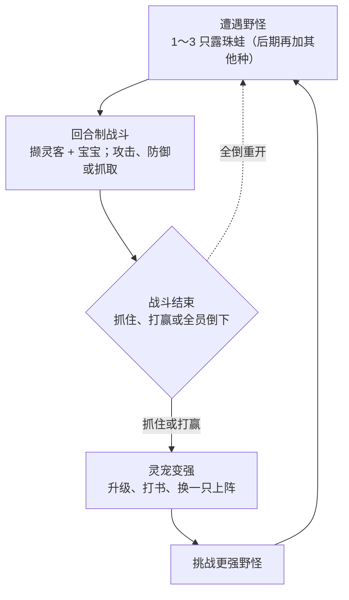

本文档是设计依据，与卡片冲突时以卡片为准。

# 青丘灵录·第一阶段玩法设计

给华周边做边学用的第一阶段设计：战斗框架按 10v10 预留，当前是 1 个撷灵客加 1 只宝宝，对随机 1～3 只野怪。先做战斗和抓宠，再做升级和打书。数值全部来自已有模拟（种子 20261110）与配置，每项决策后都有为什么这样设计。

## 目录

- [一句话定位](#一句话定位)
- [本阶段范围](#本阶段范围)
- [核心循环](#核心循环)
- [各系统设计](#各系统设计)
  - [回合制战斗](#回合制战斗)
  - [抓宠](#抓宠)
  - [资质与变异](#资质与变异)
  - [三种野怪与升级](#三种野怪与升级)
  - [打书](#打书)
- [前 5 分钟体验](#前-5-分钟体验)
- [模拟关键数字](#模拟关键数字)
- [卡片开发顺序](#卡片开发顺序)
- [试玩验证标准](#试玩验证标准)
- [待定问题](#待定问题)

## 一句话定位

「青丘灵录」（临时名）是一款 2D 横屏单机回合制灵宠养成游戏。第一阶段只做一件事：让玩家在战斗里抓住灵宠，再靠打怪升级和打书把它养强，然后去挑战更难的野怪。

- **临时名**：青丘灵录
- **画面**：横屏 1334×750，2.5D 斜视角：敌方左上斜排，我方右下（角色后排、宝宝前侧）
- **技术**：Cocos Creator 3.8 + TypeScript，先做网页版并部署到 GitHub Pages
- **以后**：同一套工程可再出微信、抖音小游戏

> **先验证战斗和抓宠好不好玩**
>
> 合宠和装备都排在后面。功能一次加太多，就分不清是哪一部分好玩。玩法灵感来自梦幻西游，但名字、专有名词和美术全部原创，不用「召唤兽」「炼妖」「兽决」等词。

## 本阶段范围

### 本阶段做

- 10v10 站位框架；当前 1 个撷灵客 + 1 只宝宝 vs 随机 1～3 只露珠蛙
- 回合制战斗：先各自选指令和目标，再按速度结算；可攻击、防御
- 战斗中抓宠（由角色发起），残血越低越好抓，抓住后 2.5% 变异
- 第一阶段后期再加 3 种野怪、打怪升级、打书
- 资质随机；同时只有 1 只灵宠上阵
- 打书：最多 4 格，满格时 32% 顶掉一个旧技能

### 本阶段不做

- 合宠（两只合一只、偏赌运气，排在打书之后）
- 装备鉴定（装备给角色穿；本阶段角色已参战，但不做装备）
- 存档、联网、复活
- 技能在战斗中生效、多只编队、背包管理

为什么这样设计：养成游戏最容易一开始就做大。抓宠、升级、打书、合宠、装备都围着战斗转；如果战斗和抓宠不好玩，后面都是空的。一次只验证一环，才知道是哪一步好玩。

## 核心循环

为什么这样设计：核心循环就是玩家会反复走的那条路。抓、升级、打书都要能让下一场打得更好、抓到更好的宠，这条路才会自己转起来。

学到的：做游戏可以想成三层。机制是规则（怎么抓、怎么升级）；动态是玩家真会怎么玩（压血再抓、专刷变异）；体验是他心里的感觉（紧张、赌一把、收集）。我们先定规则和想要的感觉，再用模拟看玩家会不会真这么玩。数字不对就改配置文件，不必先改画面。

## 各系统设计

下面每一项都是规则加已有数值。没写进配置的数字（比如升级经验）不编造，见文末待定问题。

### 回合制战斗

战斗框架按 10 对 10 预留站位：我方最多 5 个角色、每个带 1 只宝宝，对面最多 10 只怪物。当前只上 1 个角色「撷灵客」加 1 只宝宝「露珠蛙」，对面随机刷 1～3 只野外露珠蛙。数量概率放在配置里：1 只 50%、2 只 35%、3 只 15%。

画面是 2.5D 斜视角：敌方在左上斜排，我方在右下（角色后排、宝宝站在其前侧）。顶部中间是回合数和出指令倒计时（29 秒）；右侧竖排「灵术 / 秘技 / 攻击 / 行囊」，原型只开攻击，其余置灰；底部横排「抓取 / 撤离 / 防御 / 自动」，卡 01 先开防御、卡 02 再开抓取。正在等指令的我方单位头顶显示「准备中」；右上角是角色和宝宝头像，带血条。

撷灵客 1 级（无资质，本阶段不做角色成长和装备）：生命 58、攻 10、防 13、速 9。宝宝是 1 级、中资质、非变异的露珠蛙：生命 38、攻 11、防 10、速 10。每个单位显示名字、等级、当前和最大生命。

每回合先进入指令阶段：我方每个还站着的单位各自选指令和目标，再按速度统一结算。速度高的先行动；同速时我方先于敌方，同一边按站位编号从小到大。怪物 AI 随机打一个还站着的我方单位。目标若在出手前已经倒下，自动改打一个仍存活的敌人。倒计时结束还没选完的单位，自动对一个存活敌人使用「攻击」。本阶段技能只显示名字，不生效。

$$
伤害 = \max(1,\ \mathrm{round}((攻 − 防 \times 0.40) \times 随机\ 0.86\text{–}1.14))
$$

防御：本回合该单位不出手。结算开始时就进入防御姿态（不必等到自己的行动次序），受到的物理伤害先减半再至少保留 1 点。下回合指令阶段开始时解除。

胜负：一方所有单位气血为 0 或全部撤离才判负。角色气血为 0 是「倒地」（本场可被复活，原型不做复活）；宝宝气血为 0 本场不能再出战。单位倒下后不再行动，但不直接判负。

为什么这样设计：先把 10 对 10 的站位框搭好，以后加角色和宝宝不用推翻布局。每个单位先选完指令再一起结算，玩家才有时间看清楚、做选择。如果撷灵客一倒就输，宝宝就成了摆设；一方全部倒下才算输，角色和宝宝都重要，也跟 10 对 10 的框架一致。防御是整回合的姿态，不是轮到自己才举盾，否则速度快的敌人先打，点防御就没有意义。角色生命和防御比宝宝高、攻击略低，他更像能扛一下的御灵者。前 5 分钟多数是 1～2 只，偶尔 3 只才有压力。

### 抓宠

抓取由角色发起，并选一只还活着的野怪。宝宝不能代抓。角色已倒地时不能抓。打死不可抓，提示「已倒下，无法抓取」。失败则该野怪还在，本回合其他单位仍按已选指令结算，野怪仍会出手。抓住展示物种、四项资质、是否变异；变异要明显标出。失败的抓取不判定变异。

$$
p = \mathrm{clamp}(基础抓取率 + 0.58 \times (1 − 当前生命 / 最大生命)^{1.15},\ 0.06,\ 0.82)
$$

三种野怪的基础抓取率（满血时）不一样：露珠蛙 20%，岩角羊 11%，疾风貂 7%。压到约 22% 血时，分别约 63.6%、54.6%、50.6%。卡 02 先只抓露珠蛙。1 级撷灵客加中资质宝宝、压到约 22% 血再抓的模拟：对 1 只 100% 抓住，平均 2.8 回合；对 2 只 99.9% 全部抓住；对 3 只 99.0% 至少抓住 1 只、83.6% 全部抓住（战斗胜率同为 83.6%）。按 50%/35%/15% 混合刷怪时，战斗胜率 97.6%，99.9% 至少抓住 1 只，平均一场抓住 1.61 只，平均 4.6 回合。

为什么这样设计：这是「风险与回报」。再打两下成功率更高，但可能打死（抓不到）或被反击倒下。满血也能抓，但很难，避免玩家觉得只能硬等。成功率有上下限（6%–82%），满血不是零、残血也不是必中，留着意外。失败不抽变异，是因为玩家看不见的抽奖不应该发生。

### 资质与变异

每个资质在物种区间里独立掷两次整数再平均、四舍五入。抓住后 2.5% 变异；变异时四项资质各乘 1.18，再封顶 130。按抓住的只数计，大约 40 只出一只变异。按现在 1～3 只混合遭遇压血抓，平均约 25.1 场见到一只（中位数 17，P90 为 55），因为一场可能抓住多只。

为什么这样设计：资质决定这只宠长大后能有多强，是收集的乐趣。掷两次再平均，大多数会落在中间，特别高和特别低都少，极品才显得珍贵。变异是「变动奖励」：不是每次都有，偶尔的惊喜比每次固定奖励更能让人想再来一次。乘 1.18 且有上限，让变异明显更强，又不会无限膨胀。

### 三种野怪与升级

| 项目 | 露珠蛙 | 岩角羊 | 疾风貂 |
| --- | ---: | ---: | ---: |
| 定位 | 入门均衡，好抓 | 防体高、速度低 | 攻速高、体防低，难抓 |
| 营地等级 | 1 | 6 | 12 |
| 1 级基础 生命/攻/防/速 | 38 / 11 / 10 / 10 | 44 / 12 / 14 / 7 | 30 / 14 / 8 / 15 |
| 满血抓取率 | 20% | 11% | 7% |
| 天生技能 | 露珠弹 | 角抵 | 迅斩 |
| 技能池 | 5 个 | 5 个 | 5 个 |

野外个体资质取各区间中点，再把算出来的四维和生命乘 0.88（幼体略弱）。玩家露珠蛙按中资质非变异成长：1 级生命 38、攻 11、防 10、速 10；10 级为 83 / 23 / 22 / 22；20 级为 133 / 36 / 37 / 35。

$$
生命 = 基础生命 + \mathrm{floor}(体资质 \times \tfrac{1}{18} \times (等级 − 1))
$$

$$
攻 / 防 / 速 = 对应基础 + \mathrm{floor}(对应资质 \times \tfrac{1}{52} \times (等级 − 1))
$$

当前第一、二张卡的对战是「撷灵客 + 宝宝 vs 1～3 只野外露珠蛙」，见抓宠和模拟数字。下面这组仍是单宝宝对营地野怪的对照，供后面加岩角羊、疾风貂时用：1 级对露珠蛙胜率 100%，对另两种是 0%。6 级对岩角羊胜率 56%，8 级才稳赢。10 级对疾风貂胜率 59.4%，12 级才稳赢。所以「约 6 级再碰岩角羊、约 10 级再碰疾风貂」是可以尝试的时机，不是稳赢。抓它们还要先能压血；1–5 级不要去硬抓。疾风貂难抓不只是因为抓取率低，还因为它先手、伤害高，压血时你可能自己倒下。

为什么这样设计：三种野怪是三道门槛，不是三张皮。露珠蛙好打好抓，保证前 5 分钟有正反馈。岩角羊肉、疾风貂疾，用来告诉玩家该去升级了。野外幼体乘 0.88，是为了让 1 级中等资质的露珠蛙能压血抓同种野怪。

### 打书

给一只已抓住的灵宠打技能书，从该物种技能池随机抽一本。技能格最多 4 格，开局占 1 格天生技能。未学会且有空格：直接学会。已学会：这本书浪费，技能不变。格子已满且是新技能：32% 顶掉一个随机旧技能，否则失败、技能不变。

模拟（每种 5 个技能）：打 5 本后约 61.4% 的宠已满 4 格；打 10 本后约 96% 满格。再往下打，主要在换技能，也会浪费更多书（打 20 本平均顶技能 0.93 次、因已学会而浪费约 14 本）。

为什么这样设计：先给一段稳定变强（前几本大概率学会新技能），再进入赌博（满格后 32% 顶掉旧的，也可能浪费）。已学会就浪费，会让玩家开始在意「这本书该不该打」。本阶段技能只出现在列表里，战斗中不生效，避免和「普攻抓宠好不好玩」混在一起。

## 前 5 分钟体验

1. **打开就进战斗**
   左上是 1～3 只野外露珠蛙，右下是撷灵客在后、宝宝在前，名字和生命一眼看得见。不要长说明、不要先选关卡。
2. **给两个单位出指令，看懂出手顺序和日志**
   宝宝速度最快，通常先出手。一整场大约一分钟内能玩完。打 1～2 只应轻松赢。
3. **压到约两成血，让角色去抓**
   按混合遭遇，99.9% 至少抓住 1 只，平均一场 1.61 只。对 1 只时 100% 能抓住，平均 2.8 回合。前几分钟里应能抓住第一只。
4. **看抓住结果**
   物种、四项资质、是否变异。变异很少见，不要期待前 5 分钟就出现。
5. **重开再打，弄懂几条规则**
   残血更好抓；打死就抓不到；宝宝倒下，角色还能继续打。遇到 3 只会更久、血更少，偶尔会输，这是有意留下的压力。

为什么这样设计：很多玩家只会给你几分钟。这几分钟里必须让他赢一场、抓住第一只，并且看懂「残血更好抓」。这叫前 5 分钟正反馈。1 只和 2 只占 85%，模拟里几乎都会赢；3 只只占 15%，用来制造偶尔的紧张，而不是开场就把人劝退。

## 模拟关键数字

种子 20261110。当前对战是 1 级撷灵客（生命 58、攻 10、防 13、速 9）加 1 级中资质非变异露珠蛙，对野外露珠蛙（再乘 0.88）。我方集火生命最低的敌人，敌人随机目标。模拟抓取时由角色压到约 22% 血再抓，宝宝打其他目标或防御。每组 8000 场。

### 抓取与前期

剩余生命对应的抓取成功率：

| 剩余生命 | 露珠蛙 | 岩角羊 | 疾风貂 |
| ---: | ---: | ---: | ---: |
| 100% | 20% | 11% | 7% |
| 70% | 34.5% | 25.5% | 21.5% |
| 50% | 46.1% | 37.1% | 33.1% |
| 30% | 58.5% | 49.5% | 45.5% |
| 22% | 63.6% | 54.6% | 50.6% |
| 10% | 71.4% | 62.4% | 58.4% |
| 5% | 74.7% | 65.7% | 61.7% |

| 情况 | 战斗胜率 | 至少抓住 1 只 | 全部抓住 | 平均回合 | 宝宝倒地 |
| --- | ---: | ---: | ---: | ---: | ---: |
| vs 1 只 | 100% | 100% | 100% | 2.8 | 0% |
| vs 2 只 | 99.9% | 100% | 99.9% | 5.5 | 4.9% |
| vs 3 只 | 83.6% | 99.0% | 83.6% | 8.3 | 50.9% |
| 按权重混合 | 97.6% | 99.9% | — | 4.6 | — |

单次抓取成功率约 55.2%～55.5%（有时会在略高于 22% 血时就开始抓，以免下一击打死）。对 3 只时角色倒地 16.4%。按抓住的只数计，大约 40 只出一只变异；按混合遭遇场次计，平均 25.1 场见到一只（中位数 17，P90 为 55）。变异率本身仍是 2.5%。

### 对战胜率

| 数量 | 只攻击胜率 | 压血抓取胜率 |
| --- | ---: | ---: |
| 1 只 | 100% | 100% |
| 2 只 | 100% | 99.9% |
| 3 只 | 90.9% | 83.6% |

| 数量 | 只攻击胜率 | 平均回合 | 胜场中宝宝倒下仍赢 | 压血抓取胜率 | 至少抓住 1 只 |
| --- | ---: | ---: | ---: | ---: | ---: |
| 1 只 | 100% | 3.0 | 0% | 100% | 100% |
| 2 只 | 100% | 5.1 | 0.3% | 99.9% | 100% |
| 3 只 | 90.9% | 9.0 | 50.2% | 83.6% | 99.0% |
| 按权重混合 | 98.8% | 4.6 | — | 97.6% | 99.9% |

对 3 只只攻击时负 9.1%，平均约 9 回合，胜场里约一半会宝宝先倒下、角色再打赢，这就是「较稳赢但有压力」。按权重混合负 1.2%。单宝宝对岩角羊、疾风貂营地的旧对照仍在 results.txt 附录里，供后面的卡使用。

### 打书

| 打书次数 | 满 4 格比例 | 平均顶技能 | 平均浪费 |
| --- | ---: | ---: | ---: |
| 5 本 | 61.4% | 0.04 次 | 2.30 本 |
| 10 本 | 96.3% | 0.30 次 | 6.10 本 |
| 20 本 | 100% | 0.93 次 | 14.09 本 |
| 30 本 | 100% | 1.57 次 | 22.09 本 |

三种物种都是 5 个技能的池，分布几乎一样。表中为露珠蛙的结果。打 5 本时还有约 34.5% 停在 3 个技能。

### 资质

#### 露珠蛙

| 资质 | 区间 | 普通均值 | P10 / P50 / P90 | 变异均值 |
| --- | ---: | ---: | ---: | ---: |
| 攻 | 50–90 | 70.2 | 59 / 70 / 81 | 82.8 |
| 防 | 55–95 | 75.4 | 64 / 75 / 87 | 88.9 |
| 体 | 70–110 | 90.3 | 79 / 90 / 102 | 106.5 |
| 速 | 50–90 | 70.2 | 59 / 70 / 82 | 82.9 |

#### 岩角羊

| 资质 | 区间 | 普通均值 | P10 / P50 / P90 | 变异均值 |
| --- | ---: | ---: | ---: | ---: |
| 攻 | 55–95 | 75.3 | 64 / 75 / 87 | 88.8 |
| 防 | 75–115 | 95.2 | 84 / 95 / 107 | 112.3 |
| 体 | 75–115 | 95.3 | 84 / 95 / 107 | 112.4 |
| 速 | 40–80 | 60.2 | 49 / 60 / 72 | 71.1 |

#### 疾风貂

| 资质 | 区间 | 普通均值 | P10 / P50 / P90 | 变异均值 |
| --- | ---: | ---: | ---: | ---: |
| 攻 | 70–110 | 90.2 | 79 / 90 / 102 | 106.4 |
| 防 | 40–80 | 60.2 | 49 / 60 / 72 | 71.1 |
| 体 | 45–85 | 65.2 | 54 / 65 / 76 | 76.9 |
| 速 | 75–115 | 95.3 | 84 / 95 / 107 | 112.3 |

## 卡片开发顺序

一次只做一张卡，每张做完都要能玩。华周只验收效果，不看代码。数值全部放在 `src/config.ts`，不要写死在战斗脚本里；规则计算写成纯 TypeScript，和界面分开。界面尽量用代码搭，没有美术时用色块和文字代替。做完只说玩家能看到什么、怎么试；没跑过的不要说通过。

1. **卡 01：角色 + 宝宝的回合制战斗**
   撷灵客 + 露珠蛙 vs 随机 1～3 只野外露珠蛙。2.5D 斜视角，攻击、选目标、防御，按速度结算，一方全倒才判负，可重开。验收：两个单位都要出指令，出手顺序对，防御减伤看得到，打 1～2 只轻松赢、打 3 只有压力，倒下一个不直接判负。能学到：先指令后结算的回合循环、10 站位阵型、选目标和防御。设计上学：为什么一方全倒才判负，为什么防御要整回合生效。
2. **卡 02：战斗中抓宠、变异和资质**
   在卡 01 上加：由角色发起抓取并选一只野怪，残血更好抓，抓住展示资质和变异，打死不可抓。验收：满血难抓、残血更好抓、打死抓不到、偶尔见到变异、前几分钟能抓住第一只。能学到：在已有回合里加新指令；设计上学风险与回报、前 5 分钟正反馈。
3. **卡 03：三种野怪可选，抓住后看清楚**
   开打前可选露珠蛙、岩角羊、疾风貂。抓住后进入展示页：物种、等级、是否变异、四项资质、当前四维、天生技能名。变异要有独立外观提示。验收：三种野怪打起来不一样，展示页一眼看得懂。能学到：用数据驱动多种生物和选择界面；设计上学「差异要让玩家不用看数字也能感觉到」。
4. **卡 04：打怪升级（1 级到 20 级）**
   战斗胜利给经验，升级后按成长公式刷新属性，页面上能看到升级前后的数字。验收：前期稳抓露珠蛙，约 6 级能开始碰岩角羊，约 10 级能开始碰疾风貂。做这张卡前必须先补经验表，见待定问题。能学到：把成长公式落到画面上，并用反馈让「变强」被看见；设计上学成长节奏。
5. **卡 05：打书学技能、顶技能**
   按上面规则打书。验收：能看到学会、已拥有而浪费、顶掉哪一个、失败这四种结果；打若干本后技能列表会变。建议先做一枚「打一本技能书」按钮，不先做掉落。能学到：把概率结果说清楚；设计上学先稳后赌的变动奖励。
6. **卡 06：用抓住的一只宠上阵**
   可把已抓住的一只设为出战（同时只有 1 只），带着它的资质、等级、技能和变异去打三种野怪。默认仍是开场那只露珠蛙，直到玩家改选。验收：换上强宠之后，打起来明显不一样。能学到：把一只宠的状态带到下一场（先放内存里即可）；设计上学「收集到的东西要能用起来，循环才算闭环」。

为什么这样设计：一次一张卡，正好适合边做边学。先把多方战斗打通，再加抓宠，每张卡只引入一类新问题。数值集中配置、逻辑与表现分离，改概率时只改配置，以后也方便加测试和换皮。

## 试玩验证标准

找 2–3 个没玩过的人，各玩约 5 分钟。先不解释规则，看他们自己会怎么玩。不要直接问「好玩吗」，问下面这些更具体的问题。本阶段不做存档，试玩前要告诉对方：刷新页面会丢进度。

- 前几分钟里有没有抓住第一只？用了多久？
- 两个单位出指令、选目标，搞得清楚吗？防御有没有感觉到少挨打？
- 满血抓和残血抓，有没有感觉到差别？
- 打死不能抓，这规则让人紧张，还是只觉得负面？宝宝倒下后还能打，这规则感觉公平吗？
- 打 3 只的时候是觉得有点意思，还是太难、太烦？
- 打完一场，想不想再打一场？
- 三种野怪打起来有没有明显不同（肉、快、好抓难抓）？
- 升级后的数字变化看不看得懂？有没有变强的感觉？
- 打书时，学会、浪费、顶掉旧技能，哪一种让你印象最深？想不想继续打？
- 有没有觉得无聊、看不懂或不公平的地方？

如果 2–3 个人都能在 5 分钟内抓住第一只，并且打完想再来，第一环就算站住了。再决定是否往下做合宠和装备。

## 待定问题

> **两份数字还没有，先别拍脑袋**
>
> 升级所需经验、每场给多少经验，以及技能书从哪里来，现有配置里都还没有。做卡 04、卡 05 之前要先补模拟，不要临时填一个数。撷灵客目前只用 1 级基础属性，角色成长公式也还没有。

1. 升级经验表未定。补完后要能对上「约 6 级碰岩角羊、约 10 级碰疾风貂」的节奏。
2. 角色成长公式未定。本阶段撷灵客只用 1 级基础值，不做装备。
3. 抓住算不算胜利、给不给经验，未定。建议：抓住和打赢都给经验，具体数量先跑模拟。
4. 技能书从哪里来，未定。建议：卡 05 先做一枚「打一本」按钮，把规则玩明白，掉落以后再加。
5. 物种名与「青丘」山海经风格是否替换，见下表。现用名可先用，改名只改配置。
6. 正式游戏名与商标。「青丘灵录」是临时名，定名前再查第 9 类、第 41 类商标。
7. 技能何时在战斗中生效。不在本阶段，避免干扰抓宠验证。

| 现用名 | 定位 | 建议名 | 理由 |
| --- | --- | --- | --- |
| 露珠蛙 | 入门均衡 | 汀蛙 | 汀是水边，更贴青丘水泽 |
| 岩角羊 | 防体高 | 岩羬 | 羬羊出自山海经 |
| 疾风貂 | 攻速高 | 风狸 | 传说中能乘风的狸类 |

上表只是建议，不改现有配置。青丘是九尾狐的故乡，以后新宠可以更多从山海经里找灵感；前三只入门宠不强求都是狐。
